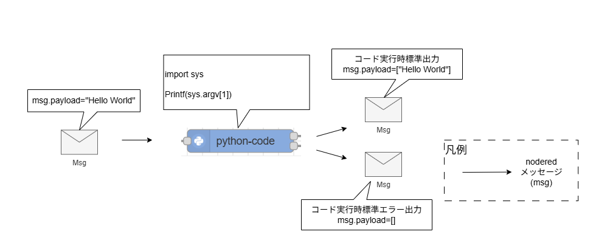
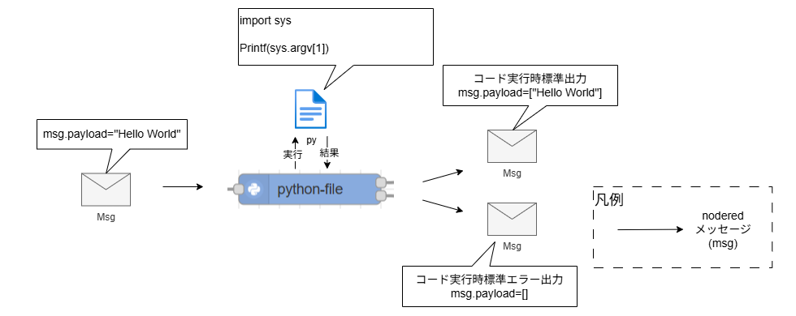
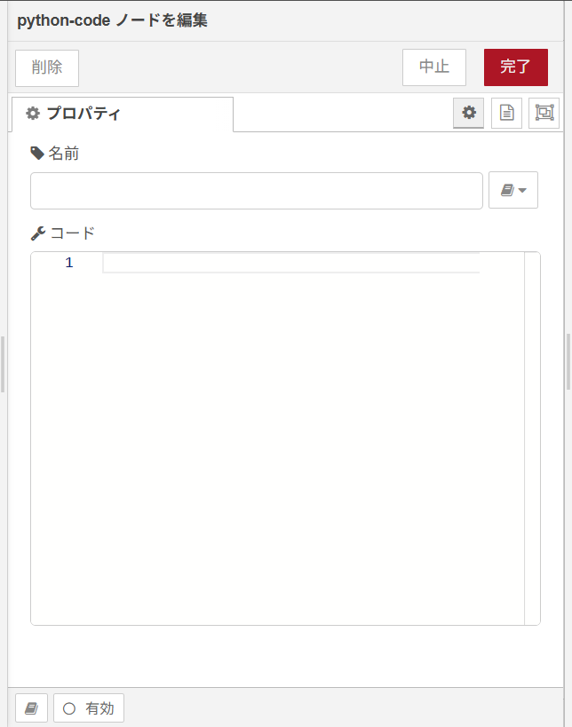
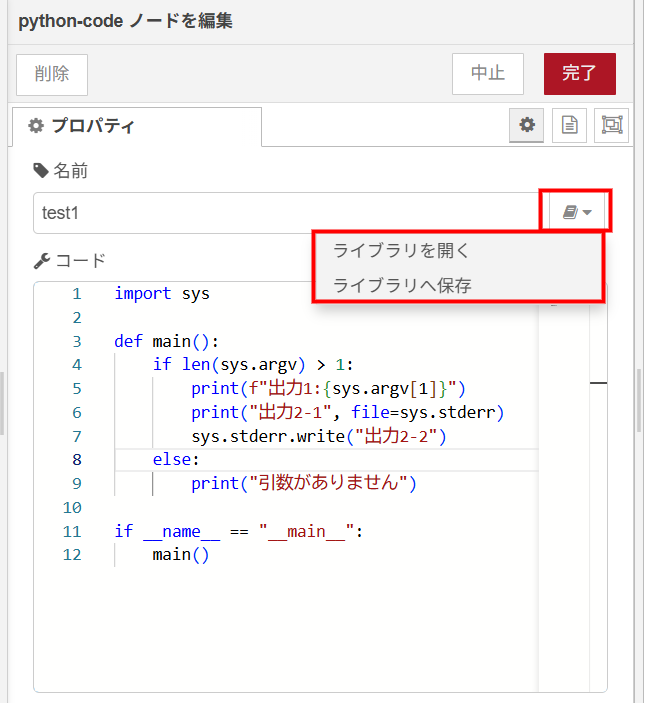
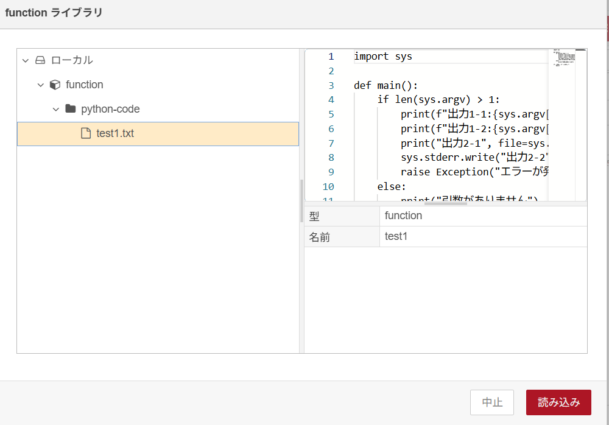
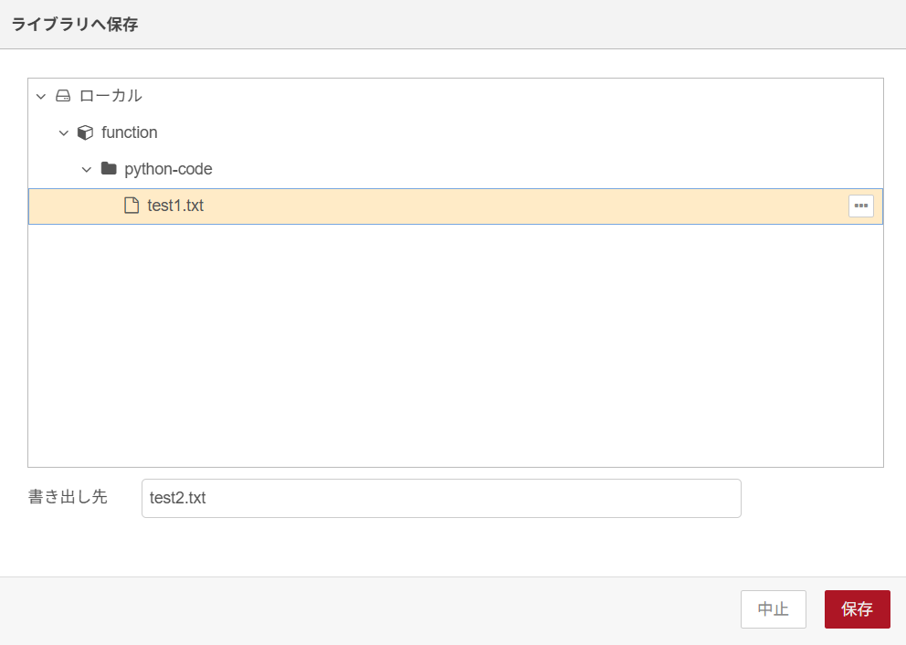
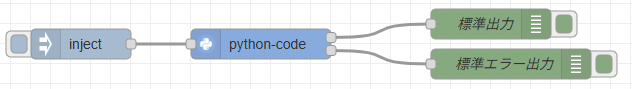
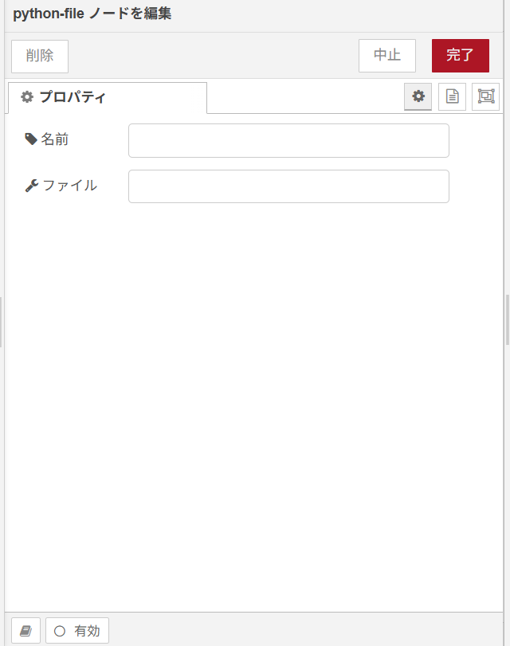
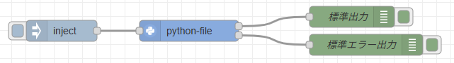

# node-red-python

## 目次

* [概要](#概要)
* [ノードの設定](#ノードの設定)
  * [環境変数](#環境変数)
  * [コンテナーの作成オプション Create Option](#コンテナーの作成オプション-create-option)
* [ノードライブラリの説明](#ノードライブラリの説明)
  * [python-code](#Node-Specification-python-code)
  * [python-file](#Node-Specification-python-file)
* [ログ出力内容](#ログ出力内容)
  * [python-code](#Log-python-code)
  * [python-file](#Log-python-file)
* [エラー時動作一覧](#エラー時動作一覧)
* [Feedback](#feedback)
* [LICENSE](#license)

## 概要

node-red-pythonは、下記処理を行うNode-REDのカスタムノードです。

## 機能

指定されたPythonコードもしくはPythonファイルを実行する機能。  
以下のノードを含む。

* python-code ノードプロパティで設定したPythonコードを実行する。  



* python-file ノードプロパティで設定したPythonファイルを実行する。  



## ノードの設定

### 環境変数

#### 環境変数の値

(なし)

### コンテナーの作成オプション Create Option

#### コンテナーの作成オプション Create Option の値

（なし）

## ノードライブラリの説明

<a id="Node-Specification-python-code"></a>

### python-code

#### 機能概要

ノードプロパティで設定したPythonコードを実行する。

#### プロパティ

  

  | プロパティ | Type    | Required | Conditions | Default     | Description                                                                                                                                                                                                   |
  | ---------- | ------- | -------- | ---------- | ----------- | ------------------------------------------------------------------------------------------------------------------------------------------------------------------------------------------------------------- |
  | 名前       | textbox | &emsp;   |            | python-code | ノードの表示名を設定。                                                                                                                                                                                        |
  | コード     | editor  | 〇       |            |             | 実行するPythonコードを記述する。<br>入力メッセージpayloadはコマンドライン引数として取得可能。<br>実行時の標準出力、標準エラー出力がそれぞれ出力端子からの出力メッセージとなる。<br>保存と読み込み機能を持つ。 |

##### コードの保存と読み込み機能について

名前プロパティの右隣にあるボタンから表示できるメニューで、コードの保存と読み込みを行うことができる。  
  

  [ライブラリを開く]

  保存した名前プロパティとコードプロパティの組み合わせを、編集中のpython-codeノードに読み込む。  

    

  [ライブラリへ保存]

  現在の名前プロパティとコードプロパティの組み合わせをファイル名を指定して保存する。  
  保存先は"[GAUDINodeREDのバインドフォルダ]/lib/functions"で、保存画面でその配下にさらに新規フォルダを作成することも可能。  
  テキストファイルとして保存され、既存のファイル名で保存した場合は上書きできる。  
  保存したファイルの削除は本機能からは不可能。  

    

#### 入力メッセージ

| JSON key | Type    | Description                                              |
| -------- | ------- | -------------------------------------------------------- |
| payload  | string※ | 任意の値。コード内部でコマンドライン引数として取得可能。 |

※ 文字列以外を入力してもコード次第ではエラーにはならないが、想定通りの動作をしない可能性が高い。

#### 出力メッセージ

入力メッセージは下記のプロパティ以外破棄される。

| JSON key | Type   | Description                                                                                                      |
| -------- | ------ | ---------------------------------------------------------------------------------------------------------------- |
| payload  | array  | 出力1端子：コード実行時の標準出力を配列としたもの。<br>出力2端子：コード実行時の標準エラー出力を配列としたもの。 |

#### 使用例1

JSON形式文字列を入力し、Pandasで値を操作する。

  [フロー構成]

  

  [プロパティ]
  
  | プロパティ | Type   | Value    |
  | ---------- | ------ | -------- |
  | コード     | editor | 下記参照 |

  ```python
  import sys
  import pandas as pd
  import json

  def main():
      if len(sys.argv) < 2:
          print("JSON形式の文字列をmsg.payloadで指定してください", file=sys.stderr)
          return
      json_str = sys.argv[1]

      # JSON文字列をリストに変換
      try:
          data_list = json.loads(json_str)
      except Exception as e:
          print(f"JSON形式の文字列の変換に失敗しました: {e}", file=sys.stderr)
          return

      # DataFrameに変換
      df = pd.DataFrame(data_list)

      # DataFrameの内容を表示（転置）
      print("=== DataFrame (転置表示) ===")
      print(df.T)

      # 数値列の最大値・最小値を表示
      print("\n=== 数値列の最大値 ===")
      print(df.select_dtypes(include='number').max())
      print("\n=== 数値列の最小値 ===")
      print(df.select_dtypes(include='number').min())

      # 行数・列数を表示
      print(f"\n=== 行数: {len(df)}, 列数: {len(df.columns)} ===")

  if __name__ == "__main__":
      main()

  ```

  [入力メッセージ]

  成功パターン

  ```json
  {
    "payload":"[{\"A\":1,\"B\":\"x\",\"C\":4.0},{\"A\":2,\"B\":\"y\",\"C\":5.0}]"
  }
  ```  

  失敗パターン

  ```json
  {
    "payload":"test"
  }
  ```

  [出力メッセージ]

  成功パターン：出力1

  ```json
  {
    "payload":[
      "=== DataFrame (転置表示) ===",
      "     0    1",
      "A    1    2",
      "B    x    y",
      "C  4.0  5.0",
      "",
      "=== 数値列の最大値 ===",
      "A    2.0",
      "C    5.0",
      "dtype: float64",
      "",
      "=== 数値列の最小値 ===",
      "A    1.0",
      "C    4.0",
      "dtype: float64",
      "",
      "=== 行数: 2, 列数: 3 ==="
    ]
  }
  ```

  成功パターン：出力2

  ```json
  {
    "payload":[]
  }
  ```  

  失敗パターン：出力1

  ```json
  {
    "payload":[]
  }
  ```

  失敗パターン：出力2

  ```json
  {
    "payload":["JSON形式の文字列の変換に失敗しました: Expecting value: line 1 column 1 (char 0)"]
  }
  ```

<a id="Node-Specification-python-file"></a>

### python-file

#### 機能概要

ノードプロパティで設定したPythonファイルを実行する。

#### プロパティ

  

  | プロパティ | Type    | Required | Conditions | Default     | Description                                                                                                                                                                                                       |
  | ---------- | ------- | -------- | ---------- | ----------- | ----------------------------------------------------------------------------------------------------------------------------------------------------------------------------------------------------------------- |
  | 名前       | textbox | &emsp;   |            | python-file | ノードの表示名を設定。                                                                                                                                                                                            |
  | ファイル   | textbox | 〇       |            |             | 実行するPythonファイルパスを設定。コンテナ内の絶対パスで入力可能。<br>入力メッセージpayloadはコマンドライン引数として取得可能。<br>実行時の標準出力、標準エラー出力がそれぞれ出力端子からの出力メッセージとなる。 |

#### 入力メッセージ

| JSON key | Type    | Description                                              |
| -------- | ------- | -------------------------------------------------------- |
| payload  | string※ | 任意の値。コード内部でコマンドライン引数として取得可能。 |

※ 文字列以外を入力してもコード次第ではエラーにはならないが、想定通りの動作をしない可能性が高い。

#### 出力メッセージ

入力メッセージは下記のプロパティ以外破棄される。

| JSON key | Type   | Description                                                                                                      |
| -------- | ------ | ---------------------------------------------------------------------------------------------------------------- |
| payload  | array  | 出力1端子：コード実行時の標準出力を配列としたもの。<br>出力2端子：コード実行時の標準エラー出力を配列としたもの。 |

#### 使用例1

JSON形式文字列を入力し、Pandasで値を操作する。

  [フロー構成]

  

  [プロパティ]
  
  | プロパティ | Type    | Value                                                           |
  | ---------- | ------- | --------------------------------------------------------------- |
  | ファイル   | textbox | /data/usecase1.py(中身はpython-code使用例1のPythonコードと同様) |

  [入力メッセージ]

  python-code使用例1と同様

  [出力メッセージ]

  python-code使用例1と同様

## ログ出力内容

<a id="Log-python-code"></a>

### python-code

| LogLevel | 出力概要                                                                                 |
| -------- | ---------------------------------------------------------------------------------------- |
| error※1  | Python実行環境初期化失敗※2<br>コードをファイルへ一時保存失敗<br>コード構文or実行時エラー |
| warn     | 無し                                                                                     |
| info     | コード構文or実行時エラー※3<br>出力1への出力メッセージ<br>出力2への出力メッセージ         |
| debug    | 無し                                                                                     |
| trace    | 無し                                                                                     |

※1 catchノードが存在する場合、ログ出力されない  
※2 Python3が存在しない場合Uncaught Exceptionが発生し、自動でモジュールが再起動する  
※3 catchノードが存在する場合でもログ出力される

<a id="Log-python-file"></a>

### python-file

| LogLevel | 出力概要                                                                         |
| -------- | -------------------------------------------------------------------------------- |
| error※1  | Python実行環境初期化失敗※2<br>ファイルパス不正エラー<br>コード構文or実行時エラー |
| warn     | 無し                                                                             |
| info     | コード構文or実行時エラー※3<br>出力1への出力メッセージ<br>出力2への出力メッセージ |
| debug    | 無し                                                                             |
| trace    | 無し                                                                             |

※1 catchノードが存在する場合、ログ出力されない  
※2 Python3が存在しない場合Uncaught Exceptionが発生し、自動でモジュールが再起動する  
※3 catchノードが存在する場合でもログ出力される

## エラー時動作一覧

| 分類                       | エラー内容                          | 動作                                                                                                                                                                                                                                                 | 出力ログレベル |
| -------------------------- | ----------------------------------- | ---------------------------------------------------------------------------------------------------------------------------------------------------------------------------------------------------------------------------------------------------- | -------------- |
| **ノードのプロパティ設定** | 必須項目未設定                      | デプロイ時エディター上に警告が出る。<br>python-fileでファイルの値が未設定のまま警告を無視してデプロイした場合は、メッセージ入力時に例外出力。<br>python-codeでコードの値が未設定の場合は、空のコードとして扱われ、何も実行されず例外も出力されない。 | error          |
|                            | ファイルパスが不正(python-fileのみ) | メッセージ入力時に例外出力。                                                                                                                                                                                                                         | error          |
| **メッセージ受信**         | Python3が存在しない                 | Uncaught Exceptionとして発生、自動でモジュールが再起動する。                                                                                                                                                                                         | error          |
|                            | Pythonコード構文または実行時エラー  | 例外出力。                                                                                                                                                                                                                                           | error          |

## Feedback

お気づきの点があれば、ぜひIssueにてお知らせください。

## LICENSE

node-red-python is licensed under the MIT License, see the [LICENSE](LICENSE) file for details.